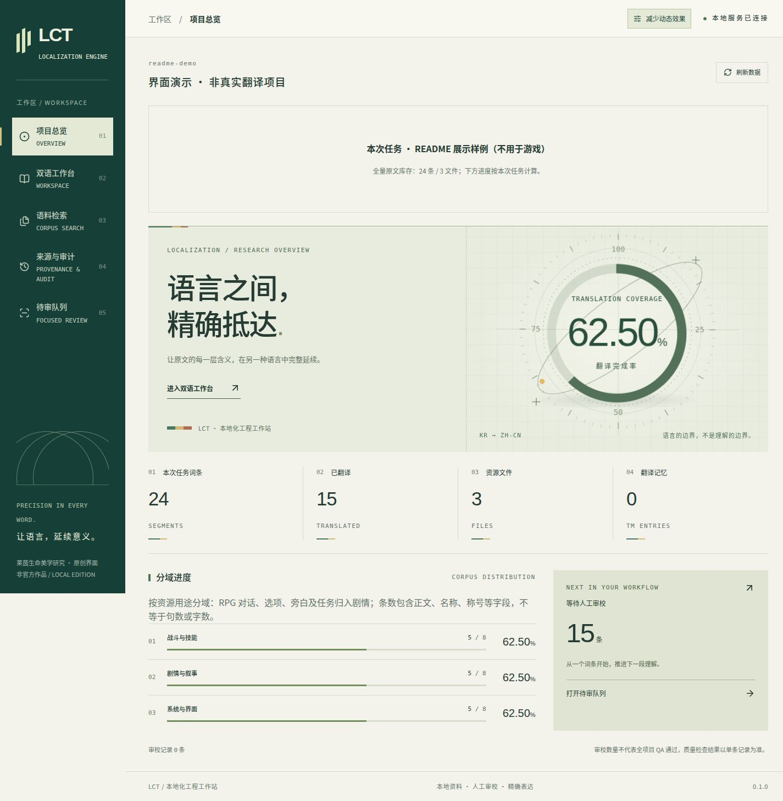
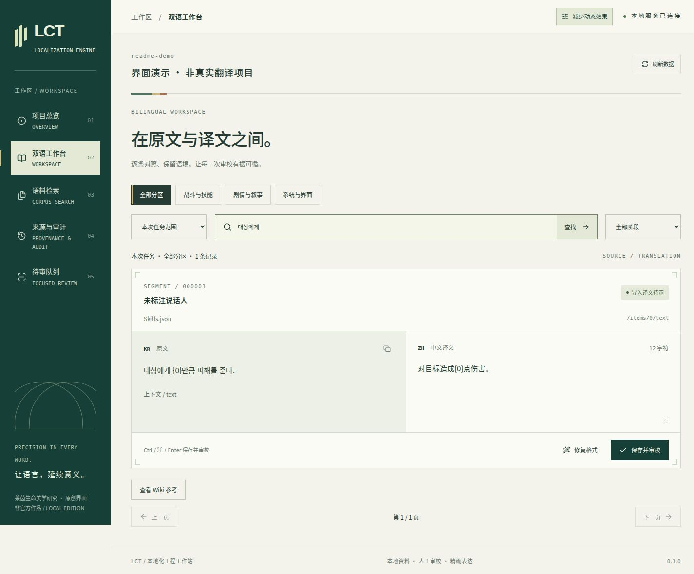
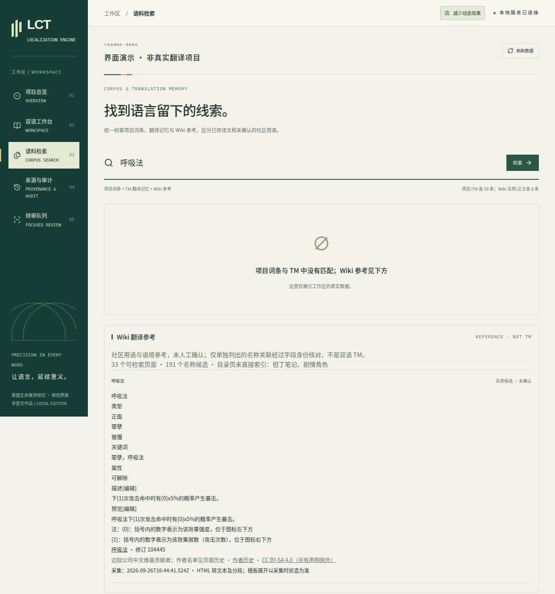

<div align="center">

# LCT · Limbus Company Translate

**A traceable path from source text to reviewed translation.**

A local KR → ZH-CN localization workstation for Limbus Company<br>
Rust CLI · Bilingual review UI · MCP interface · Offline reference corpus

[简体中文](README.md) · **English** · [Download](https://github.com/buxinzi2233/limbus-company-translate/releases) · [API guide](docs/AI_AGENT_INTEGRATION.md)

</div>



> The overview and workbench screenshots use an isolated `readme-demo` fixture, not production translations or real localization progress. The search screenshot uses the public Wiki snapshot included in the bundle. The application UI is currently in Chinese.

## More than a translation editor

LCT connects source imports, reference lookup, drafts, human review and JSON write-back in a traceable local workflow. The CLI handles engineering operations, the WebUI supports human review, and MCP exposes bounded project tools to agents.

| Capability | What it does |
| --- | --- |
| **Bilingual workbench** | Compare Korean and Chinese side by side; filter by task, resource category and stage while retaining context and field paths |
| **Reference search** | Search project segments, translation memory and Wiki references with provenance, revision IDs, attribution and licenses |
| **Incremental import** | Detect new, changed and deleted source text while preserving translations and identifying work that needs review |
| **QA and human review** | Check placeholders, numbers, rich text and formatting; passing QA never automatically approves an AI draft |
| **Write-back and recovery** | Update JSON fields by pointer, retain unrelated fields, and record backups, recovery operations and audit events |

### Interface gallery

<details>
<summary><strong>Bilingual workbench · source, context and translation in one place</strong></summary>



The example remains “imported translation awaiting review.” Imported text, a populated translation, QA success and human confirmation are distinct states.

</details>

<details>
<summary><strong>Corpus search · community references kept separate from translation memory</strong></summary>



The screenshot quotes the Chinese Limbus Company Wiki page “呼吸法” at revision 104445. Authors are listed in its page history; quoted content retains CC BY-SA 4.0 subject to page-specific notices. Provenance and transformation notices are retained in the reference database and [Wiki license record](corpus/licenses/wiki-source-license.json).

</details>

## Quick start

### Prebuilt: executable + frontend + corpus

Download `lct-linux-x86_64.tar.gz` and its `.sha256` file from [Releases](https://github.com/buxinzi2233/limbus-company-translate/releases), placing them in the same directory.

**The prebuilt executable requires Linux x86_64, glibc 2.39+ and `libgcc_s.so.1`.** Corpus preparation also requires Python 3.11+ with SQLite FTS5. Rust, Node.js and pnpm are not needed to run this package. Other platforms have no prebuilt package; building locally may work with older Linux libraries, but cross-distribution compatibility has not been certified.

```bash
sha256sum --check lct-linux-x86_64.tar.gz.sha256
tar -xzf lct-linux-x86_64.tar.gz
cd lct-linux-x86_64
sha256sum --check SHA256SUMS

python3 scripts/prepare-references.py .loc/references
./lct --data-dir .loc/work init review --name "My localization project"
./lct --data-dir .loc/work \
  --reference-db "$PWD/.loc/references/references.sqlite3" \
  ui --project-id review --port 3000 --no-open
```

Open **http://127.0.0.1:3000**. Select corpus search (“语料检索”) and search for “呼吸法” to verify the Wiki library. Press `Ctrl+C` in the terminal to stop the service.

- An empty project inventory on first launch is expected: reference data is not automatically turned into translation tasks or completed work.
- Preparation is fully offline, verifies each file, rejects corrupt data and refuses to overwrite an existing destination.
- `.loc/work` is the writable project store; `.loc/references/references.sqlite3` is the separate read-only reference library.

### Build from source

Install Rust/Cargo, Node.js and pnpm. The workspace declares Rust 1.89; this release was built with Rust 1.98.1, Node.js 26.10.0 and pnpm 11.26.0. The minimum toolchain combination has not been validated.

```bash
git clone https://github.com/buxinzi2233/limbus-company-translate.git
cd limbus-company-translate
pnpm --dir ui install --frozen-lockfile
pnpm --dir ui build
cargo build --release --locked -p loc-cli
```

Build the frontend first: the release executable embeds `ui/dist`. Follow the initialization steps above, replacing `./lct` with `./target/release/lct`. The source checkout also includes the complete `corpus/` data.

## The bundled corpus

This is a fixed **2026092702 Chinese reference snapshot**, not a continuously updated online service.

| Content | Coverage |
| --- | --- |
| Original Zero Association release ZIP | 2,237 JSON source files and the original license |
| Chinese field indexes | 173,300 text fields and 28,997 name fields—not unique-term counts or translation progress |
| Wiki reference database | 35 captured pages, 33 searchable; 285 name-candidate records representing 191 distinct names; 191 passages |
| Distribution support | Provenance manifest, SHA-256 checksums, offline preparation script, third-party licenses and modification notices |

Machine-local source and metadata paths have been replaced with portable paths. See [corpus/manifest.json](corpus/manifest.json) for versions and provenance.

**A Chinese reference library is not aligned KR–ZH translation memory.** The current WebUI/MCP community-reference endpoints search Wiki content. Original Zero Association JSON is restored to `.loc/references/zh-CN`; its field indexes remain in the reference database’s `corpus` / `terms` tables and are not searched by those endpoints.

To build bilingual TM, supply legally obtained, version-matched Korean JSON and explicitly index it:

```bash
./lct --data-dir .loc/work index \
  --kr /absolute/path/to/matching/KR \
  --zh "$PWD/.loc/references/zh-CN" \
  --origin zero-association-2026092702 --priority 100
```

No private project database, personal drafts, review state, draft permits, Korean game resources or game binaries are distributed. Snapshot upgrades are explicit, never silent startup downloads.

## Workflow and MCP

```text
Prepare matching source and reference versions
                    ↓
Index TM → Extract source → Confirm task scope
                                    ↓
                         Draft → QA → Human review
                                    ↓
                           Write-back → Audit / Restore
```

Commands include `init`, `index`, `extract`, `search`, `qa`, `fix`, `scope-import`, `scope-status`, `draft-grant`, `draft-revoke`, `inject`, `restore`, `ui` and `mcp`. Check arguments with `./lct <command> --help`.

Agents connect over stdio using the same project store and an explicit project ID:

```bash
./lct --data-dir .loc/work \
  --reference-db "$PWD/.loc/references/references.sqlite3" \
  mcp --project-id review
```

Use absolute paths when registering this command with an MCP client. Without `--draft-permit`, the connection is read-only. Draft writes require a prior human-issued permit pinned to the task and source snapshot. The project Skill is in `.agents/skills/lct-localization/`; see the [agent integration guide](docs/AI_AGENT_INTEGRATION.md) for tools, grants and read-back rules.

## Safety and scope

- **Local, single user:** HTTP listens on loopback only and has no remote authentication. Do not expose it through a public proxy.
- **Human final review:** reference candidates, imported translations, AI drafts and passing QA do not constitute human confirmation.
- **Bounded guarantees:** QA is not proof of semantic accuracy or correct in-game rendering. MCP write restrictions are not host-level permission isolation.
- **Validate before production use:** use a separate working directory first, and verify destination paths before injection or recovery.
- **Unofficial:** this tool is not affiliated with Project Moon or Zero Association and does not claim authorship of third-party reference material.

## Development and packaging

```text
crates/       core · parser · tm · qa · server · cli · mcp
ui/           React + Vite local review interface
corpus/       public reference snapshot, checksums and separate licenses
scripts/      offline preparation, integration acceptance and packaging
docs/         API guide, design notes, validation boundaries and UI screenshots
```

Run from the source checkout:

```bash
cargo test --locked --workspace
pnpm --dir ui format:check
pnpm --dir ui test:editor
python3 scripts/verify-corpus.py "$PWD"
bash scripts/package-release.sh /absolute/output-directory
```

Packaging installs locked dependencies and builds both frontend and backend in a temporary source directory, then verifies out-of-tree startup and real HTTP/MCP reference search. Archives include screenshots, corpus, licenses and checksums. Run `python3 scripts/accept-release.py /absolute/path/to/unpacked/lct` for additional release acceptance. Remaining sign-off and safety boundaries are tracked in the [validation checklist](docs/PRODUCTION_TODO.md).

## Licenses and acknowledgements

- **Tool code:** [MIT](LICENSE) · Antigravity & Hackimi Localization Team.
- **Zero Association corpus:** retains **CC BY-NC-SA 4.0** under its [original license](corpus/licenses/ZeroAssociation-LICENSE.txt).
- **Wiki content:** retains site-default **CC BY-SA 4.0**, subject to page-specific notices, contributor attribution, page history and third-party rights; see the [license record](corpus/licenses/wiki-source-license.json). Third-party quotations in screenshots retain their original licenses.

The software’s MIT license does not cover this third-party content. Read the respective licenses before using or redistributing the corpus.
